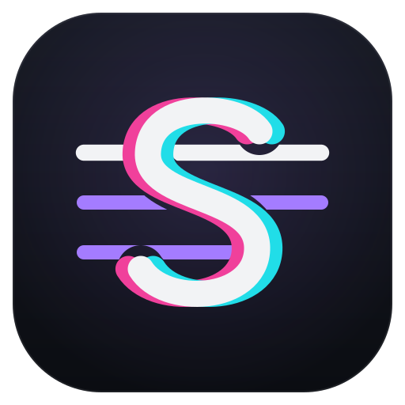

<p align="center">
  
</p>

# Scribix — transcriptor local

> **Scribix** es el nombre de producto del Transcriptor dentro de la suite
> (Scribix → Lyrixa → Vibrix). El repo, los módulos, las variables
> `TRANSCRIPTOR_*` y los contratos siguen llamándose "transcriptor"; el nombre
> solo cambia lo que se ve. Marca e iconos en `webapp/static/brand/`.

App web para transcribir audio/video y sacar letras de canciones **100% en tu
propia máquina** con [Whisper](https://github.com/openai/whisper), BS-RoFormer y
[Demucs](https://github.com/facebookresearch/demucs). El audio nunca sale de tu
equipo: no usa ninguna API en la nube.

Progreso en vivo: modelo, dispositivo (CPU/GPU), barra de avance y cada segmento
con su tiempo `inicio → fin` conforme se genera (vía SSE).

## Modos

| Modo | Qué hace |
|------|----------|
| 🎧 **Transcribir** | Texto con timestamps de un link de YouTube o un archivo. |
| 🎤 **Letra de canción** | Aísla la voz con BS-RoFormer o Demucs y luego la transcribe. |
| 🎯 **Letra ultra precisa** | 1 o 3 lecturas, voto y rescate selectivo; traducción opcional. |
| ⬇️ **Solo audio** | Descarga audio de YouTube en MP3, M4A, Opus, OGG, FLAC, ALAC, WAV u original. |
| 🎞️ **Solo video** | Descarga video para uso personal en MP4, MKV o WebM, desde 360p hasta 4K o máxima disponible. |

## Trabajos guardados e iteraciones

La pantalla **Trabajos guardados** descubre automáticamente las carpetas de
`webapp/output/`. Desde ahí puedes volver a abrir descargas y reproductores o
reprocesar un modo ultra reutilizando `asr-input.wav`/`vocals.wav`. Cada nueva
iteración archiva los JSON, subtítulos, textos y el manifiesto exacto bajo
`iterations/iteration-NN`; el audio y los stems grandes no se duplican.
El botón cambia a **Reanalizar usando la voz guardada**: valida con `ffprobe`
que el checkpoint tenga la duración completa y nunca vuelve a ejecutar el
separador. Si `asr-input.wav` está incompleto, prueba el stem vocal; si ambos
fallan, conserva la salida anterior y se detiene.

Cada fila muestra modelo, motor efectivo, tiempo de ejecución y espacio usado.
**Eliminar** borra permanentemente únicamente el trabajo elegido —audio,
stems, resultados e iteraciones—, pide confirmación y se bloquea si todavía
está corriendo.

El selector muestra parámetros, descarga aproximada, velocidad y calidad, no
solo `small` o `medium`. Debajo aparece el artefacto exacto que se ejecutará,
por ejemplo `mlx-community/whisper-turbo` o
`Systran/faster-whisper-large-v3-turbo`, y si ya está descargado.

## Modo ultra: por qué deja de inventar letra

Una pasada de Whisper a veces inventa una frase sobre una nota sostenida y a
veces se come una al borde de una ventana. Las dos fallas son **inestables**:
cambia la temperatura de decodificación o mueve el corte de ventana y se mueven
con ellas. La letra real no se mueve.

El modo ultra transcribe el audio una o tres veces con ajustes deliberadamente
distintos, alinea las hipótesis palabra por palabra y deja que cada posición
vote. Una palabra que oyó una sola pasada pierde contra el silencio que oyeron
las demás; una que oyeron todas sobrevive aunque la escriban distinto. Las
zonas dudosas se pueden revisar desde la mezcla original; con Turbo ese rescate
usa `large-v3` sin volver a procesar todo el mix.

Antes de transcribir mide la separación (nivel, cobertura de canto y fuga
instrumental) y usa detección de actividad vocal para transcribir **solo donde
se canta**: eso elimina de raíz la alucinación sobre silencio y, en una mezcla
de tres horas, ahorra la mitad del cómputo.

### Guía de canciones para mixes

En modo ultra puedes pegar o cargar un `.txt` con una línea por canción:

```text
00:00 Rollergirl - Dear Jessie (Green Court Remix)
01:25 T-Pau - China in Your Hand
```

Si la lista contiene secciones como `Original Tracklist:` y
`Nightcore Tracklist:`, la app elige la que encaja con la duración real. De
forma opcional consulta LRCLIB y guarda `track-guide.json`: una ventana solo
recibe versos cuando realmente se encontró letra; artista y título nunca son
un prompt de Whisper. Una línea pública solo reemplaza la ortografía cuando la
coincidencia ya es alta, porque un remix puede cortar o reordenar la letra.
La app distingue una canción sin coincidencias de un fallo de red, reintenta
estos últimos y prefiere referencias que incluyan timestamps sincronizados.
Los errores temporales `429/503` usan espera progresiva y, si alguno sobrevive,
se vuelve a consultar al terminar de aislar la voz y antes de iniciar Whisper;
las referencias ya encontradas no se descargan de nuevo.

El desglose completo — perfil de separación de doble pasada, ventanas
desfasadas, alineación con Needleman–Wunsch, guardia de bucles de repetición y
tiempos esperados — está en [`webapp/README.md`](webapp/README.md#modo-ultra).

## Traducción e idiomas (local)

La traducción empieza en **Sin traducción**. Si la eliges, o la añades después
desde Trabajos guardados, usa un modelo local vía [Ollama](https://ollama.com)
sin repetir la separación ni Whisper:

- **Detección de idioma tramo por tramo.** Un DJ set de una hora no tiene un
  solo idioma, así que no se detecta uno para el archivo: se detecta en *cada*
  ventana con voz. Solo si un idioma cubre más del 97% del canto se fuerza
  el archivo (es más estable); si no, la mezcla se marca como multilingüe y
  cada tramo se transcribe en el idioma en que se cantó. Un cambio de idioma
  que dura una sola ventana se descarta como ruido.
- **Una ruta de traducción por idioma de origen.** En un mix con canciones en
  japonés y en inglés, las líneas japonesas van por `ja→en→es` y llevan romaji;
  las inglesas van por `en→es`. Antes había una sola ruta para todo el archivo,
  y eso es exactamente lo que hacía que un tema japonés saliera en inglés.
- **Japonés en romaji**, con la lectura correcta en contexto (君の名は →
  `kimi no na wa`, no `kun no mei ha`).
- **Pivote por inglés** para escrituras no latinas: ruso → inglés → español.
- **Una traducción por línea, siempre**: los lotes se piden numerados y se
  verifican; si algo falla se reintenta línea a línea y, en último caso, se
  conserva el original. Una capa desplazada rompería toda la sincronía.

## Motor local: la API

El Transcriptor no es «la web del 8000»: es el motor, y la interfaz HTML es
solo uno de sus clientes. Lyrixa y el renderer son los otros, y hablan con él
por HTTP sin que nadie tenga que buscar archivos a mano.

| Ruta | Para qué |
|------|----------|
| `GET /api/health` | ¿Está vivo el motor? Lo primero que pregunta un lanzador. |
| `GET /api/jobs/{id}` | Metadata del trabajo, con un bloque `links`. |
| `GET /api/jobs/{id}/lyrixa` | El proyecto `.lyrixa.json`, por id y no por nombre de archivo. |
| `GET /api/jobs/{id}/audio` | El audio original. Responde a `Range`, así que se puede buscar dentro de una mezcla de tres horas sin descargarla. |
| `POST /api/jobs/{id}/cancel` | Cancela solo ese trabajo y conserva los archivos completos; el servidor sigue funcionando. |
| `POST /api/translate` | Traducción y romaji como servicio, con el mismo motor que usa el pipeline. |

Nada de esto lleva un puerto escrito dentro: `TRANSCRIPTOR_HOST`,
`TRANSCRIPTOR_PORT` y `TRANSCRIPTOR_LYRIXA_URL` los decide quien arranque el
proceso, y `GET /api/info` devuelve los valores resueltos en su bloque
`service`. Una futura shell de escritorio podrá levantar los tres procesos en
los puertos que elija.

El permiso de CORS es solo para `localhost`. El servidor escucha en loopback,
de modo que el único riesgo real sería una página remota usando el navegador
del usuario como puente — y ese es justo el caso que se niega.

### Abrir en Lyrixa

Cuando un trabajo tiene proyecto, la fila de descargas muestra un botón
**🎛️ Abrir en Lyrixa** que abre el editor con el trabajo ya cargado: proyecto
y audio, sin descargar ni importar nada a mano.

El enlace lo arma el backend, porque es el único que sabe bajo qué dirección se
ve a sí mismo:

```
http://127.0.0.1:5173/?job=<id>&transcriptor=http%3A%2F%2F127.0.0.1%3A8000
```

Los dos parámetros son los que lee `bridgeConfig.ts` en Lyrixa. El segundo es
lo que hace que funcione con el puerto real: sin él Lyrixa cae en su valor por
defecto y el enlace solo sirve mientras corra su proxy de desarrollo.

El contrato completo está en
[`docs/contrato-lyrixa.md`](docs/contrato-lyrixa.md), y el lenguaje de la capa
de efectos en [`docs/contrato-capa-fx.md`](docs/contrato-capa-fx.md).

## Puente hacia Lyrixa

Además de conservar las salidas originales de Whisper, cada transcripción
genera un proyecto de autoría `.lyrixa.json`.

Los segmentos largos se dividen con los timestamps reales de `words[]`. El corte
no es glotón: se minimiza un coste sobre **todos** los repartos posibles a la
vez, premiando los cortes en coma o punto y penalizando los párrafos
desequilibrados. Por eso no sale una línea con veinte palabras y la siguiente
con dos. Si los timestamps por palabra faltan o están incompletos, se conserva
el segmento original completo como fallback.

La salida general de la transcripción también corta las frases después de coma,
punto, interrogación o exclamación. Las comas muy cortas se mantienen juntas
para no producir una línea por palabra; cuando Whisper omite la puntuación se
aplican límites de 8 segundos, 14 palabras y 84 caracteres. El mismo reparto se
usa en pantalla, texto, JSON, SRT y VTT.

Con traducción activa, el proyecto llega a Lyrixa con **dos capas de texto**:

| Capa | `role` | Contenido |
|------|--------|-----------|
| `layer-main` | `primary` | La letra (romaji si el original era japonés) |
| `layer-backing` | `translation` | La traducción, con los mismos tiempos al ms |

Cada línea de letra tiene una **identidad propia** (`line-000042`) que las dos
capas comparten en su `sourceId`, así que siguen emparejadas aunque después
edites los tiempos o reordenes los clips. La identidad se acuña cuando la
segmentación ya decidió cuáles son las líneas: un segmento de Whisper partido
en tres son tres líneas distintas, y numerarlas por su origen les daría la
misma. En una mezcla real de una hora eso afectaba al 21% de los clips.

Las dos capas de texto salen **en anclas distintas** (letra abajo, traducción
arriba). Los dos renderizadores colocan los clips de una capa de forma absoluta
según su ancla, así que dos capas con la misma se dibujarían una encima de la
otra. Si prefieres la traducción justo debajo de la letra, muévela con
*Position Y* en LiveWallpaper (pestaña Lyrics → Capas del Bundle) o cambia el
ancla en el inspector de capas de Lyrixa.

### Cuándo desaparece una línea

El timestamp de la última palabra marca dónde acaba el *alineamiento del
token*, no dónde deja de sonar la vocal cantada. Una línea que se apaga en ese
instante se siente como si el párrafo cambiara antes de que termine la voz. Por
eso cada línea **se queda 0,7 s de más**, pero solo hacia el silencio que la
sigue: si otra línea entra antes, se corta 50 ms antes de ella y le cede el
turno. Nunca hay dos líneas de la misma capa en pantalla a la vez.

En Lyrixa usa **More → Import project (.lyrixa.json)** y después carga el mismo
audio para revisar el timeline. Tras editar, usa **Export lyrics bundle** para
obtener el `.lyrixa-lyrics.json` que consume LiveWallpaperAnimeGlitch, donde la
capa de traducción se puede mostrar u ocultar desde la pestaña de Lyrics.

Al terminar el modo de letras, el resultado también muestra reproductores y
descargas para la voz aislada y el instrumental. Se sirven directamente desde
la salida del separador elegido, sin recomprimir ni duplicar los WAV, para poder
auditar qué material recibió Whisper.

La separación ofrece cuatro perfiles. **Ultra** pasa BS-RoFormer dos veces y se
queda con la que mide mejor — la segunda solo gana si baja la fuga instrumental
sin perder canto, así que nunca sale peor que Preciso. **Preciso**
(predeterminado) es una pasada de BS-RoFormer y recupera bien voces débiles;
**Equilibrado** usa Demucs con dos shifts y 50% de solapamiento; **Rápido** usa
una sola pasada de Demucs.

## Arrancar

```bash
cd webapp
./run.sh
```

Abre **http://127.0.0.1:8000** en el navegador.

Si macOS cierra la sesión o el servidor se reinicia durante un modo ultra, al
volver a abrir la página aparece **Retomar desde el audio guardado**. La app
reutiliza `asr-input.wav` (o la voz aislada si aún no existía) y no repite la
descarga ni la separación vocal.

## Requisitos

- `python3`
- `ffmpeg` y `yt-dlp` (para leer audio/video y descargar de YouTube)
- `openai-whisper` (motor de transcripción)
- BS-RoFormer *(opcional, recomendado para letras)*: `cd webapp && ./setup_separator.sh`
- `demucs` *(opcional)* — perfiles equilibrado/rápido: `pip3 install demucs`

Para el modo ultra:

- `faster-whisper` — varias veces más rápido, que es lo que hace viable correr
  varias lecturas sobre una mezcla de tres horas. Sin él, el modo ultra sigue
  funcionando con `openai-whisper`, solo que más lento.
- `mlx-whisper` — motor preferido automáticamente en Apple Silicon; usa Metal
  y se instala al arrancar por primera vez.
- [Ollama](https://ollama.com) con un modelo multilingüe, para la traducción y
  el romaji: `ollama pull qwen3.5`. Sin él la transcripción funciona igual;
  solo se pierde la segunda capa.
- `pykakasi` *(opcional)* — romaji de respaldo sin Ollama.

Las dependencias del backend (`fastapi`, `uvicorn`, `python-multipart`,
`mutagen`, `numpy`, `faster-whisper`, `pykakasi`) las instala `run.sh` la
primera vez.

Las descargas desde YouTube conservan el título original del video. Cuando el
formato lo permite, también incluyen título, artista, álbum, fecha y portada
incrustada. WAV no admite portada.

Más detalles en [`webapp/README.md`](webapp/README.md).

## Arquitectura

El backend está separado en capas cuyas dependencias apuntan siempre hacia
abajo: el servidor conoce el motor, y el motor no conoce el servidor. Eso es lo
que permite llamar al pipeline desde una CLI, una prueba o una futura shell de
escritorio sin levantar FastAPI.

El mapa de módulos y las reglas están en
[`docs/arquitectura.md`](docs/arquitectura.md). No son una convención escrita:
`tests/test_module_boundaries.py` las comprueba.

## Tests

```bash
python3 -m unittest discover -s tests -v
```
